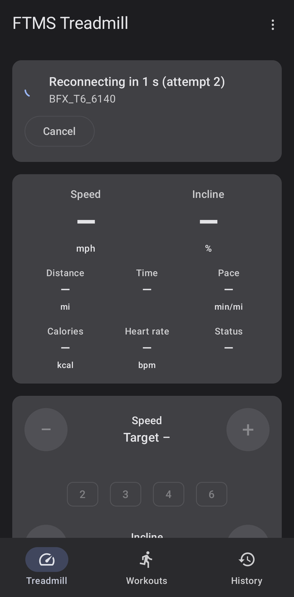
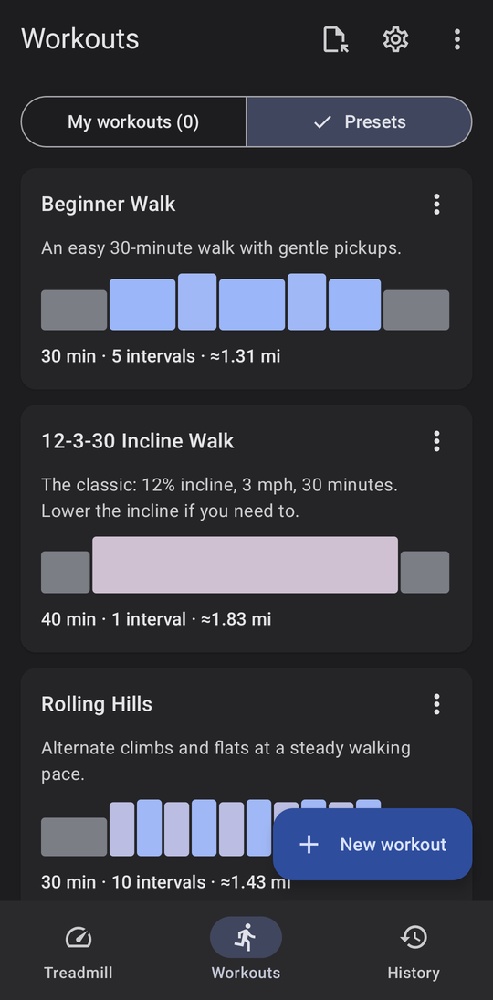
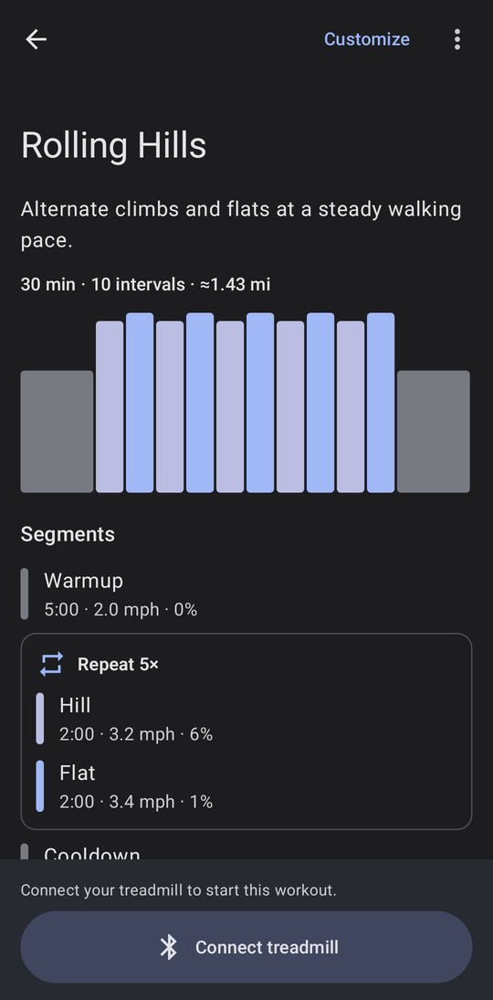
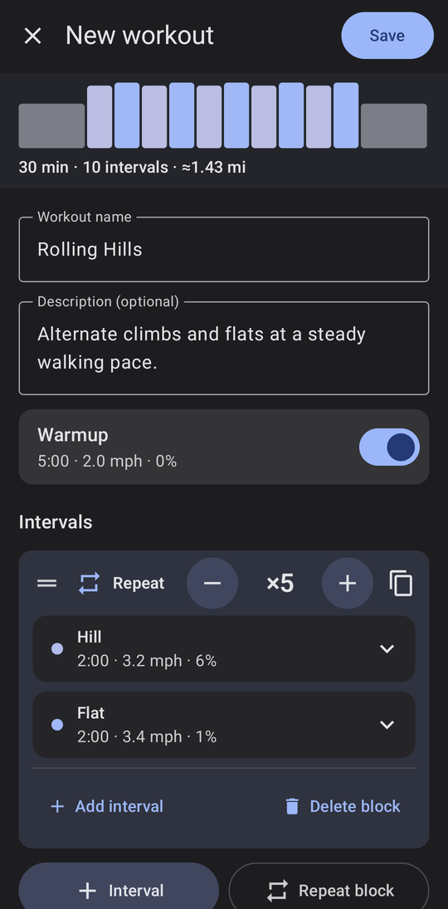
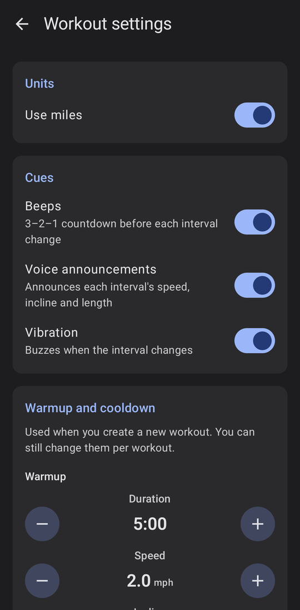

# FTMS Treadmill

An Android app for controlling a Bluetooth treadmill that supports the **Fitness Machine Service (FTMS)** standard. Connect your phone to the treadmill to see live stats, set speed and incline, and run interval workouts that change speed and incline for you. Finished workouts are saved to your history and can be sent to Health Connect.

<p align="center">
  
  
  
</p>

## Requirements

- An Android phone running **Android 12 (API 31) or newer** with Bluetooth Low Energy.
- A treadmill that advertises the Bluetooth **FTMS** service. Many recent treadmills do. If yours only works with its maker's own app, it probably doesn't support FTMS.
- Optional: [Health Connect](https://play.google.com/store/apps/details?id=com.google.android.apps.healthdata), if you want to share workouts with apps like Google Fit or Samsung Health.

## Getting started

### 1. Grant Bluetooth permission

The first time you open the app, the **Treadmill** tab asks for permission to find and connect to nearby devices. Tap **Grant permission**. The app only uses this permission to talk to the treadmill. It doesn't use your location.

If you denied the permission earlier, tap **Open settings** and allow *Nearby devices* for FTMS Treadmill.

### 2. Connect to your treadmill

1. Turn the treadmill on. Make sure it isn't connected to another app or device, since most treadmills accept only one connection at a time.
2. Tap **Connect**. The **Nearby treadmills** sheet lists FTMS treadmills in range, with their signal strength.
3. Tap your treadmill. The status card shows **Connecting…**, then **Connected**.

The app remembers this treadmill and reconnects to it automatically next time. You can change that behavior from the **⋮** menu on the Treadmill tab:

| Menu option | What it does |
| --- | --- |
| **Use miles** | Switches between mph / miles and km/h / kilometers. |
| **Auto-reconnect** | Reconnects automatically if the connection drops or when you reopen the app. |
| **Forget treadmill** | Clears the saved treadmill so you can pick a different one. |

While you're connected, a notification shows the current speed and has **Stop belt** and **Disconnect** buttons, so you can control the treadmill without opening the app.

> **Connected (monitor only)** means the treadmill is sharing its data but hasn't let the app control it. You'll see live stats, but speed and incline commands may be rejected. Check whether the treadmill needs to be unlocked, or has a setting that allows remote control.

## Manual control


The **Treadmill** tab shows live data from the treadmill:

- **Speed** and **Incline**
- **Distance**, **Time** and **Pace**
- **Calories**, **Heart rate** and **Status**, when the treadmill reports them

Below the stats are the controls:

- **Speed**: tap **−** / **+** to adjust by 0.1 mph (or 0.1 km/h), or tap a shortcut (2, 3, 4, 6 mph or 3, 5, 8, 10 km/h) to jump straight to that speed.
- **Incline**: tap **−** / **+** to adjust.
- **Start**, **Pause** and **STOP** control the belt.

A dash (**–**) means the treadmill isn't sending that value right now.

<br clear="right">

> ⚠️ **Safety:** The app is not a safety device. Keep the treadmill's safety key clipped on, and know where its own **STOP** button is. If the Bluetooth connection drops, the app shows a **Connection lost** warning, because the belt may still be running.

## Workouts


The **Workouts** tab has two lists:

- **Presets**: built-in workouts that are ready to run, including *Beginner Walk*, *12-3-30 Incline Walk*, *Rolling Hills*, *Pyramid*, *HIIT 30/30* and *Couch to 5K: Week 1*.
- **My workouts**: workouts you've created or customized.

Each card shows the workout's length, number of intervals and approximate distance, plus a profile chart. Taller bars are faster and darker bars are steeper.

<br clear="right">

### Running a workout


1. Tap a workout to see its segments: an optional warmup, the intervals (which can include repeat blocks), and an optional cooldown.
2. If the treadmill isn't connected, tap **Connect treadmill**.
3. Tap **Start workout**. After a short **Get ready** countdown, the app sets the treadmill's speed and incline at the start of each interval.

While the workout is running:

- The screen shows the current interval (**Interval 3 of 10**, **Round 2 of 5**), the time elapsed and left, and what's **Up next**.
- Adjusting speed or incline during an interval changes **that interval only**. Tap **Reset** to go back to the planned values.
- **Skip to next interval** moves on early.
- **Pause** stops the clock. Pausing on the treadmill itself also pauses the workout. If the connection drops, the workout pauses and waits for the treadmill to reconnect.
- **End workout** stops the treadmill and saves what you've done so far to History.

You can leave the workout screen while a workout runs. A bar at the bottom of the app and the notification both show its progress, and tapping either one brings you back.

<br clear="right">

### Creating and editing workouts



- Tap **New workout** to build one from scratch.
- On a preset, tap **Customize** to start from a copy of it, or choose **Add to My workouts** from its **⋮** menu.
- On one of your own workouts, use the **⋮** menu to **Edit**, **Duplicate**, **Export** or **Delete** it.

In the editor:

- Give the workout a **name** and, if you like, a **description**.
- Turn the **Warmup** and **Cooldown** on or off, and tap them to change their duration, speed and incline.
- Tap **+ Interval** to add a single interval, or **Repeat block** to add a group of intervals that repeats. Use **−** / **+** on a block to set how many times it repeats.
- Tap an interval to expand it and set its duration, speed and incline.
- Drag the **═** handle to reorder intervals.
- The profile chart at the top updates as you edit.

Tap **Save** when you're done. If you close the editor without saving, the app asks before throwing away your changes.

<br clear="right">

### Workout settings



Tap the ⚙ icon on the Workouts tab to set:

- **Units**: miles or kilometers.
- **Cues** during a workout:
  - **Beeps**: a 3–2–1 countdown before each interval change.
  - **Voice announcements**: reads out each interval's speed, incline and length.
  - **Vibration**: buzzes when the interval changes.
- **Warmup and cooldown**: the default duration, speed and incline for new workouts. You can still change them in each workout.
- **Health Connect**: turn on **Send workouts automatically** to export every finished workout.

<br clear="right">

## History

The **History** tab lists your completed workouts, with a summary of **This week** at the top. Tap a workout to see:

- Total time, distance, average speed and calories.
- A chart comparing the planned profile with your actual average speed in each segment.
- Which intervals you completed or skipped, and whether you ended early.

From there you can **Run again**, **Send to Health Connect**, or delete the record. Deleting a record from History doesn't remove anything you've already sent to Health Connect.

## Health Connect

FTMS Treadmill can write finished workouts to Health Connect so other fitness apps can show them. It writes exercise sessions (with their intervals), distance, calories burned (when the treadmill reports them) and speed. It **never reads** any of your health data.

To export one workout, open it in History and tap **Send to Health Connect**. The first time you do this, Health Connect asks you to allow access. To export every workout automatically, turn on **Send workouts automatically** in Workout settings.

## Importing and exporting workouts

Workouts are stored as plain JSON files, so you can back them up, share them, or write your own.

- **Export one workout** from its **⋮** menu, or **Export all workouts** from the **⋮** menu on the Workouts tab.
- **Import** with the import icon on the Workouts tab, or by opening or sharing a `.json` workout file with FTMS Treadmill from your file manager, browser or messaging app.

### File format

```json
{
  "format": "ftms-workout",
  "version": 1,
  "name": "Rolling Hills",
  "description": "Alternate climbs and flats at a steady walking pace.",
  "units": "mph",
  "warmup": { "duration": "5:00", "speed": 2.0, "incline": 0 },
  "intervals": [
    {
      "repeat": 5,
      "intervals": [
        { "name": "Hill", "duration": "2:00", "speed": 3.2, "incline": 6 },
        { "name": "Flat", "duration": "2:00", "speed": 3.4, "incline": 1 }
      ]
    }
  ],
  "cooldown": { "duration": "5:00", "speed": 2.0, "incline": 0 }
}
```

| Field | Notes |
| --- | --- |
| `name` | Required. |
| `description` | Optional. |
| `units` | `"mph"` or `"km/h"`. Applies to every speed in the file. Defaults to `"mph"`. |
| `warmup`, `cooldown` | Optional single segments. |
| `intervals` | A list of segments and/or repeat blocks. A repeat block has a `repeat` count and its own `intervals` list. |
| `duration` | `"m:ss"` (for example `"2:30"`) or a whole number of seconds. |
| `speed`, `incline` | Speed in `units`. Incline is a percentage and defaults to `0`. |
| `name` (on a segment) | Optional label, such as `"Hill"`. |

A file can contain a single workout, a JSON array of workouts, or `{ "workouts": [ ... ] }`, which is what **Export all** writes. Comments and trailing commas are allowed. If a file can't be imported, the app explains what's wrong with it.

## Troubleshooting

| Problem | Try this |
| --- | --- |
| **No treadmills found** | Make sure the treadmill is on, close any other app that might be connected to it, then tap **Scan again**. Some treadmills only advertise over Bluetooth for a short time after they're switched on. |
| **Device is not an FTMS treadmill** | The device doesn't offer the FTMS service, so this app can't control it. |
| **Bluetooth is off** | Tap **Turn on Bluetooth** on the status card. |
| **Connected (monitor only)** or **The treadmill did not allow that command** | The treadmill hasn't granted control. Some treadmills only accept commands after the belt has been started from the console. |
| **Treadmill stopped by safety key** | Re-attach the safety key, then start again. |
| **Keeps reconnecting** | Move the phone closer to the treadmill's console, or turn off **Auto-reconnect** and connect manually. |

## Building from source

The project is a standard Gradle Android project written in Kotlin with Jetpack Compose.

- Android Studio (recent stable) or the Android SDK command-line tools
- JDK 17 or newer

```bash
./gradlew assembleDebug
```

To build and install on a connected device:

```bash
./gradlew installDebug
```
